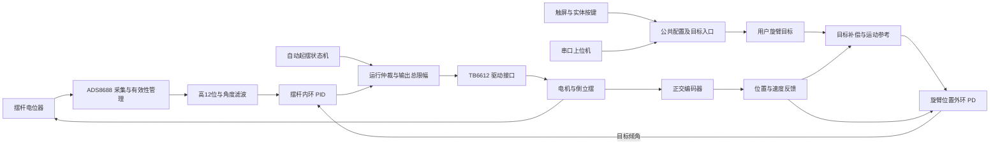

# 系统架构与模块职责

## 顶层组织

`ads8688_uart_top` 是系统唯一综合顶层，负责公共参数寄存器、运行状态机、命令仲裁和子模块连接。运行状态包括停止、等待直立、直立闭环、故障、自动起摆和阶段完成。公共目标入口检查运行状态、参数范围和行程，触屏与串口不各自维护独立的控制算法。

## 硬件源文件索引

| 功能域 | 文件 | 关键职责 |
| --- | --- | --- |
| 系统协调 | `ads8688_uart_top.v` | 配置、运行状态、命令优先级、驱动仲裁和遥测 |
| 采集链路 | `ads8688_spi32.v` | 转换器串行帧收发 |
| 采集链路 | `ads8688_checked_if.v` | 配置与数据检查，恢复转换状态 |
| 采集链路 | `ads8688_angle_if.v` | 高12位提取、样本有效性和超时状态 |
| 采集链路 | `adc_one_euro_filter.v` | 角度自适应滤波与小数状态 |
| 反馈 | `quadrature_decoder.v` | 正交译码和非法跳变统计 |
| 控制 | `pid_native.v` | 摆杆内环、测量微分、积分限幅和抗饱和 |
| 控制 | `position_pd_native.v` | 位置外环与目标倾角限幅 |
| 控制 | `target_trim_supervisor.v` | 有界静差补偿、学习条件和变化率限制 |
| 控制 | `swing_stage1_pulse.v` | 两阶段交替脉冲起摆与角度判据 |
| 控制 | `board_target_control.v` | 步进、往复中心与定时目标切换 |
| 控制 | `reciprocal_key.v`、`reciprocal_settings_adapter.v` | 按键消抖和摆幅换算 |
| 驱动 | `tb6612_pwm.v` | 方向、占空比和周期边界锁存 |
| 通信 | `uart_rx.v`、`uart_tx.v` | 异步字节收发 |
| 通信 | `uart_config_rx.v`、`uart_packet_tx.v` | 命令解析和遥测组帧 |
| 触屏 | `tft_panel.v` | 屏幕子系统集成 |
| 触屏 | `tft_touch.v`、`tft_ui.v` | 触摸采样、坐标换算和单次操作锁存 |
| 显示 | `tft_pixel.v`、`tft_button_anim.v` | 像素生成和按压视觉反馈 |
| 显示 | `tft_region_scheduler.v` | 变化区域调度与显示快照 |
| 显示 | `tft_spi_regions.v`、`tft_spi_display.v` | 地址窗口和串行像素发送 |
| 配置 | `tft_profile_boot.v` | 上电参数装载，不包含运行命令 |
| 约束与资源 | `ads8688_test.cst`、`ads8688_test.sdc`、`*.vh`、`*.hex` | 引脚、电平、时钟、布局和字形数据 |

顶层文件还包含 `encoder_speed_estimator` 和 `turn_motion_reference` 两个辅助模块，分别承担速度估计与半圈、整圈运动参考生成。保持在同一源文件中，避免引入额外的工程依赖变更。

## 量纲与时序

| 信号或参数 | 表示方式 |
| --- | --- |
| 摆杆采集值 | ADS8688 转换结果 `[15:4]`，12位无符号码 |
| 摆杆误差及外环倾角 | 高12位采集码的有符号差值 |
| 旋臂位置 | 相对启动中心的有符号编码器计数 |
| 编码器换算 | 当前参数每转1040计数，角度等于计数乘360再除以1040 |
| 内环增益 | 比例、微分8位小数，积分12位小数 |
| 外环增益 | 16位小数 |
| 速度 | 每10毫秒的编码器计数，保留8位小数 |
| 驱动输出 | 带方向的千分比，最终再应用总占空比上限 |

内环由毫秒节拍驱动，乘加在多个系统时钟周期内顺序完成。外环周期由配置给定，保存参数为25毫秒。位置目标的运动参考、学习补偿和图形刷新分别使用自己的调度条件，不以界面刷新周期代替控制周期。

## 上位机组织

`adc_gui.pyw` 维护连接状态、命令待确认队列、遥测样本和界面变量；`adc_protocol.py` 集中处理协议；`native_profile.py` 管理参数；`angle_fullscreen.py` 复用同一数据源绘制全屏角度；`scroll_panel.py` 提供滚动布局。辅助串口工具独立于主窗口入口。

目标命令、参数设置和运行命令以板端回显为准。正常断开连接按交接流程释放串口，不直接把关窗当作停机。显示参考线保存目标生效时刻的历史；往复运行时参考线使用板端回传中心。

## 引脚与资料

具体引脚以 `src/ads8688_test.cst` 为准。模块端子的 AIN1 对应芯片首个采集通道，工程使用的通道号为0。模块供电与可编程逻辑接口电平分别按硬件连接核对，不能由名称混同。

BT0/K14、BT1/K15调整位置步进正负10度；BT2/K13、BT3/K12调整往复单边摆幅正负10度。其余未映射的实体器件不纳入本工程的控制说明。
